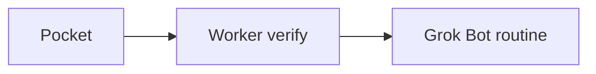

# pocket-webhook-to-grok-bot

> **Using Grok Bot?** Send it [this repo link](https://github.com/jamesalmeida/pocket-webhook-to-grok-bot) and it will walk you through setup: see [GROK_BOT_SETUP.md](GROK_BOT_SETUP.md).

A free Cloudflare Worker that lets [Pocket](https://heypocketai.com) notify a [Grok Bot](https://grok.com) webhook routine the moment a recording is ready.

## The problem

Pocket's webhook settings take a URL and a signing secret. Pocket cannot send an `Authorization` header.

A Grok Bot webhook routine requires that header on every request. Pointing Pocket straight at the routine URL delivers the event and then fails the auth check.

## The fix

This Worker sits in the middle.

1. Pocket POSTs the event to the Worker.
2. The Worker verifies Pocket's HMAC. The signed string is `${X-HeyPocket-Timestamp}.${rawBody}`, and the hex digest arrives in `X-HeyPocket-Signature`. The timestamp has to be within 5 minutes.
3. When the signature checks out, the Worker POSTs those same raw body bytes to the Grok Bot routine, with `Authorization` set from `GROKBOT_AUTH_HEADER`.

The body is forwarded as Pocket sent it. Nothing in the Worker rewrites the JSON.

It stays on the Workers free plan: no KV, Durable Objects, R2, or other paid bindings. The hostname is your account's `workers.dev` subdomain, which Cloudflare provides for personal projects. Logs and traces are on (`observability.enabled` and `observability.traces.enabled`) so `npx wrangler tail` and the dashboard show one JSON line per request. That line includes whether the signature verified, the Pocket `event` and recording `id` when those fields are present, and the downstream status. It does not include secrets or the recording body.

## Why this beats polling

A routine that opens Pocket every few hours spends a Grok Bot run even when nothing new is there. This path fires when Pocket finishes a recording, so the routine runs for a recording that is actually ready.



## Response codes

| Status | When |
| --- | --- |
| 200 | Signature checked out and the Grok Bot routine returned 2xx. The raw body was forwarded. |
| 401 | Signature missing, wrong, or stale (timestamp more than 5 minutes off). |
| 405 | The method is not POST. |
| 502 | The routine failed or could not be reached. Pocket retries. |
| 503 | `POCKET_SIGNING_SECRET`, `GROKBOT_WEBHOOK_URL`, or `GROKBOT_AUTH_HEADER` is not set. |

`GET /` returns `200` and the text `ok`. That health check does not read secrets and does not forward anything. Pocket only sends `POST`.

## Set up

### 1. Clone and install

```sh
git clone https://github.com/jamesalmeida/pocket-webhook-to-grok-bot
cd pocket-webhook-to-grok-bot
npm install
```

### 2. Log in to Cloudflare

```sh
npx wrangler login
```

Wrangler opens a browser window. Approve access for the account that should own the Worker.

### 3. workers.dev subdomain

The account needs a `workers.dev` subdomain before deploy will succeed. Register one during Workers onboarding in the dashboard ([Workers & Pages](https://dash.cloudflare.com/) → **Your subdomain**), or answer yes when Wrangler prompts to create one.

### 4. Deploy

```sh
npx wrangler deploy
```

<!-- screenshot: terminal output of npx wrangler deploy, including the workers.dev URL -->

`workers_dev` is enabled, so the command prints a URL like:

```text
https://pocket-webhook-to-grok-bot.<your-subdomain>.workers.dev/
```

That URL is public. The signing secret is what stops anyone else from pushing events through it. Keep the secret in Wrangler, not in the repo and not in chat.

### 5. Secrets

Create the Pocket webhook in the next section before these commands if you do not already have the signing secret. Pocket shows that secret once. The Grok Bot routine panel is where you copy the webhook URL and the Authorization value.

<!-- screenshot: Grok Bot routine panel showing the webhook URL and the Authorization value -->

Each command prompts for the value and hides what you type. The value is not an argument, and it is not stored in this repo. Each `wrangler secret put` saves the secret and deploys a version that includes it ([secrets](https://developers.cloudflare.com/workers/configuration/secrets/)).

```sh
npx wrangler secret put POCKET_SIGNING_SECRET
npx wrangler secret put GROKBOT_WEBHOOK_URL
npx wrangler secret put GROKBOT_AUTH_HEADER
```

| Secret | What you type at the prompt |
| --- | --- |
| `POCKET_SIGNING_SECRET` | Signing secret Pocket showed when the webhook was created. |
| `GROKBOT_WEBHOOK_URL` | Full URL of the Grok Bot webhook routine. |
| `GROKBOT_AUTH_HEADER` | The header value (`Bearer …`) or the whole line (`Authorization: Bearer …`). A leading `Authorization:` is stripped. |

Dashboard alternative: [Workers & Pages](https://dash.cloudflare.com/) → **pocket-webhook-to-grok-bot** → **Settings** → **Variables and Secrets** → **Add** → type **Secret**. Use the same three names.

### 6. Pocket

In the Pocket app, open the integrations UI for personal webhooks. Organization owners can use the [organization webhook API](https://docs.heypocketai.com/docs/api/webhooks) instead. Paste the `workers.dev` URL into the webhook URL field.

<!-- screenshot: Pocket webhook settings with the workers.dev URL in the URL field -->

Pocket shows the signing secret once, in the dialog that appears when the webhook is created. Copy it into the `POCKET_SIGNING_SECRET` prompt before you close the dialog. Deleting the webhook and adding it again rotates the secret, so run `npx wrangler secret put POCKET_SIGNING_SECRET` again after a rotation.

<!-- screenshot: Pocket's one-time signing secret dialog -->

Pocket sends `POST` with `Content-Type: application/json`, `X-HeyPocket-Signature`, and `X-HeyPocket-Timestamp`. One recording produces several events (`recording.created`, `transcription.completed`, `summary.completed`, action-item events, and others). This Worker forwards each of them. Filter and dedupe inside the Grok Bot routine. [GROK_BOT_SETUP.md](GROK_BOT_SETUP.md) tells the assistant how to write that routine.

### 7. Test

In one terminal:

```sh
npx wrangler tail
```

In another, sign a small sample and POST it. Type the signing secret only in your own shell:

```sh
POCKET_SIGNING_SECRET='the pocket secret' node scripts/send-test.mjs https://pocket-webhook-to-grok-bot.<your-subdomain>.workers.dev/
```

The script sends a `summary.completed` payload. `200` means the signature was valid and the routine returned 2xx. A real end-to-end check is a short Pocket recording: the routine should run when Pocket emits `transcription.completed`.

<!-- screenshot: a successful Grok Bot routine run for a transcription.completed event -->

The same log lines show in the dashboard under the Worker → **Observability** → **Logs**.

## Develop

```sh
npm test
npm run typecheck
npx wrangler dev
```

Local dev reads the three secrets from `.dev.vars` (gitignored):

```sh
POCKET_SIGNING_SECRET="..."
GROKBOT_WEBHOOK_URL="https://..."
GROKBOT_AUTH_HEADER="Bearer ..."
```

## License

[MIT](LICENSE) © 2026 James Almeida
